<!-- Screenshots: run source("docs/make_screenshots.R") from the package root
     after source("data-raw/make_example_data.R"). -->

```{r, echo=FALSE}
knitr::opts_chunk$set(
  echo = TRUE, eval = FALSE, message = FALSE, warning = FALSE,
  fig.align = "center", fig.width = 7, fig.height = 4.5
)
```

```{r example-results, include = FALSE, eval = TRUE}
# Example files (inst/extdata) and the results shown in the screenshots. The
# app calls these BIGpopA functions, so the numbers in the text match the app.
library(BIGpopA)
ex_dir  <- if (dir.exists("../inst/extdata")) "../inst/extdata" else system.file("extdata", package = "Familia")
ex      <- function(f) file.path(ex_dir, f)
read_ex <- function(f) utils::read.delim(ex(f), check.names = FALSE, stringsAsFactors = FALSE)
get_val <- function(df, id, col) df[[col]][match(id, df[[1]])]   # first column holds the ids

pedigree  <- read_ex("example_pedigree.txt")
genotypes <- read_ex("example_genotypes.txt")
parents   <- read_ex("example_parents.txt")
progeny   <- read_ex("example_progeny.txt")
founders  <- readLines(ex("example_founders.txt"))

clean <- check_ped(pedigree, verbose = FALSE)
val   <- validate_pedigree(read_ex("example_pedigree_cleaned.txt"), genotypes,
                           founders_file = founders, verbose = FALSE, plot_results = FALSE)
res   <- as.data.frame(val$full_results)
fp    <- find_parentage(genotypes, parents, progeny, method = "best_pair",
                        verbose = FALSE, plot_results = FALSE)
fpr   <- as.data.frame(fp$full_results)
fill  <- find_parentage(genotypes, parents, read_ex("example_pedigree_validated.txt"),
                        method = "fill_pedigree", founders_file = founders,
                        verbose = FALSE, plot_results = FALSE)
fr    <- as.data.frame(fill$full_results)

reference  <- read_ex("example_breedtools_reference.txt")
ref_ids    <- read_ex("example_breedtools_ref_ids.txt")
validation <- read_ex("example_breedtools_validation.txt")
freq  <- allele_freq_poly(reference, lapply(as.list(ref_ids), as.character), ploidy = 4)
comp  <- solve_composition_poly(validation, freq, ploidy = 4)
bt    <- assign_composition_line(comp, assign_threshold = 50)
bt$R2 <- round(comp[, "R2"], 3)
v13   <- bt[bt$ID == "V13", c("LineA", "LineB", "LineC")]
pure_pct <- c(bt$LineA[1:3], bt$LineB[4:6], bt$LineC[7:9])   # V01-V09, own line

top_markers  <- utils::head(as.data.frame(val$marker_summary), 3)
other_median <- stats::median(val$marker_summary$mismatch_pct[-(1:3)], na.rm = TRUE)
familia_version <- if (file.exists("../DESCRIPTION")) read.dcf("../DESCRIPTION", "Version")[1] else
  as.character(utils::packageVersion("Familia"))
```

# Introduction

Familia is a Shiny app that brings pedigree quality control, parentage assignment and ancestry assessment into one interface. It is a graphical front end to the [BIGpopA](https://github.com/Breeding-Insight/BIGpopA) R package (`check_ped()`, `validate_pedigree()`, `find_parentage()` and the line composition functions) and to `LEA::snmf()`.

A typical breeding program asks these questions in sequence:

1. Is the pedigree record clean (no duplicated individuals, impossible roles, loops)? -> **Pedigree Cleaner**
2. Do the recorded parents agree with the genotypes? -> **Validate Pedigree**
3. Who are the real parents of offspring with a wrong or missing record? -> **Find Parentage**
4. What is the line / breed / population composition of each sample? -> **BreedTools<sup>poly</sup>** and **SNMF**

| Tab | Use it to | Main output |
|---|---|---|
| Pedigree Cleaner | Fix structural pedigree errors before any genotype work | Corrected pedigree, issue tables |
| Validate Pedigree | Test recorded trios against genotypes | Status per trio, corrected pedigree, marker summary |
| Find Parentage | Assign or fill in parents from a candidate pool | Best parent(s), error %, ties |
| BreedTools<sup>poly</sup> | Line/breed composition from a reference panel | Composition table with R2, bar plot, Excel |
| SNMF | Unsupervised ancestry with `LEA::snmf()` | Q matrix, cross-entropy, plot |

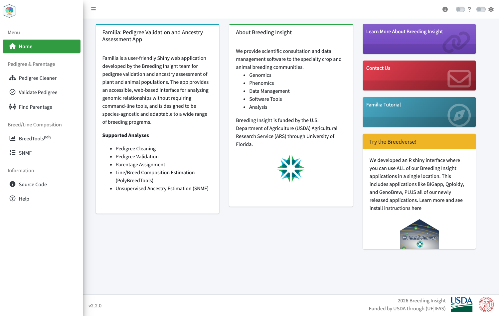

## Remarks

Familia works best when the following conditions hold:

- **Genotypes are allele-B dosages** (the number of copies of the counted allele, 0 to the ploidy) or a VCF / PLINK file, which the app converts. Dosage quality drives everything: a poor dosage call looks exactly like a Mendelian error.
- **Ploidy is correct.** The Mendelian rules depend on the gametes each parent can produce (ploidy / 2 alleles), so a wrong ploidy produces many false failures. Even ploidies use a polysomic gamete-range test (it assumes autopolyploid inheritance, so it is conservative for allopolyploids). Odd ploidies (e.g. triploid) fall back to an opposite-homozygote test on homozygous markers only, which has less power.
- **Enough informative markers.** Trio tests with few markers cannot separate a wrong parent from noise (see *Min Markers*). Hundreds of markers per individual are recommended.
- **Parents and offspring are genotyped.** Find Parentage can only find parents that are in the candidate (parents) file and in the genotype file.
- **Offspring come from normal sexual reproduction.** Selfed, inbred, doubled-haploid or clonal material can break the assumptions of the trio test (see [Tips](#tips)).

Familia does not call dosages; use your pipeline first (we recommend [BIGapp](https://github.com/Breeding-Insight/BIGapp)).

# Install and run

Install Familia from CRAN, or the latest version from GitHub, by copying and pasting this code into your R console. The SNMF tab also needs the LEA package from Bioconductor. The last line opens the app.

```{r}
# from CRAN
install.packages("Familia")
# or, instead, the latest version from GitHub
# remotes::install_github("Breeding-Insight/Familia")

# LEA for the SNMF tab (Bioconductor)
if (!requireNamespace("BiocManager", quietly = TRUE)) install.packages("BiocManager")
BiocManager::install("LEA")

Familia::run_app()
```

`run_app()` opens the app in the RStudio viewer or in your browser. Installing Familia also installs BIGpopA (>= 2.2.0).

Every tab has an **Example files** link at the top of its Inputs box, which downloads the files used in this guide, and a yellow **Help** button at the bottom, which opens the steps, the parameters and an example of each result category for that tab.

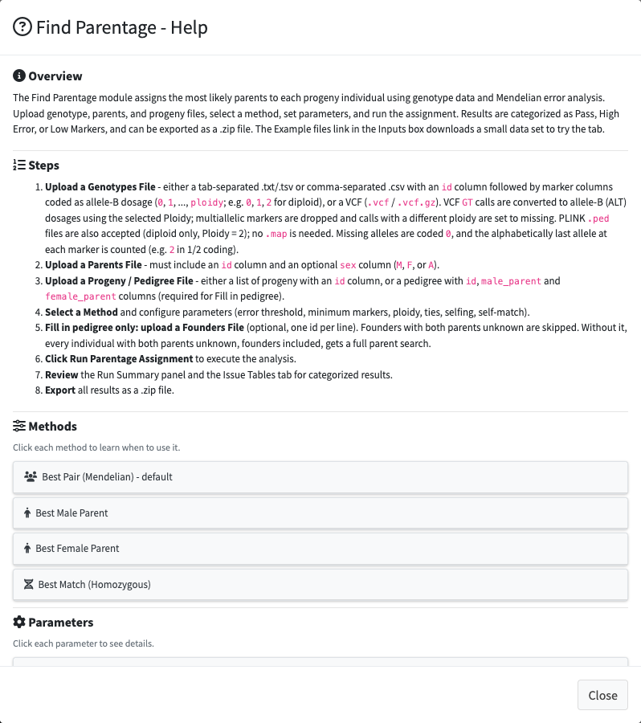

# Example data

The screenshots use a small simulated data set that contains one case of every result Familia reports, so each result can be interpreted. Download it from the Example files link of each tab, or use the copies installed with the package:

```{r}
list.files(system.file("extdata", package = "Familia"))
```

The diploid data set has six genotyped founders (`M1`, `M2`, `M3`, `F1`, `F2`, `F3`), a founder without genotypes (`M4`), `M1c`, a second sample of `M1` with the same genotypes (a clone or a duplicated sample), and 38 offspring (`C01` to `C38`), genotyped at 300 SNPs. `C12` to `C38` are correct records; the other individuals carry the cases below. The tetraploid data set has three reference lines (`LineA`, `LineB` and `LineC`, 8 samples each) and 13 samples to assign (`V01` to `V13`).

| Individual | Case | Where it shows up |
|---|---|---|
| `C02` | Its row appears twice | Pedigree Cleaner: Exact Duplicates |
| `C07` | Two rows with different male parents (`M2` and `M1`) | Pedigree Cleaner: Conflicting Trios |
| `M4` | Male parent of `C09` and female parent of `C10`, has no row of its own and is not genotyped | Pedigree Cleaner: Inconsistent Sex Roles, Missing Parents |
| `X1`, `X2` | Each recorded as the parent of the other | Pedigree Cleaner: Cycles |
| `C04` | Recorded as `M3` x `F2`, but the male parent is `M2` | Validate: `remove_male_parent` |
| `C05` | Recorded as `M2` x `F1`, but the female parent is `F3` | Validate: `remove_female_parent` |
| `C06` | Recorded as `M2` x `F2`, but the parents are `M3` x `F1` | Validate: `remove_both` |
| `C11` | Contaminated sample (DNA of two individuals) | Validate: `unresolved` |
| `C08` | Failed sample with only 8 markers called | Validate and Find Parentage: low markers |
| `M1c` | Same genotypes as `M1` | Find Parentage: ties |
| `snp050`, `snp150`, `snp250` | Miscalled markers (random calls) | Validate: Marker Summary |
| `V10` to `V13` | Admixed samples, and a sample from a line missing from the reference panel | BreedTools: `Undetermined`, low `R2` |

# Input files

All files are uploaded in the browser: text files are tab-separated (`.txt`, `.tsv`) or comma-separated (`.csv`). The required column names are matched ignoring case, spaces and dots in every tab, so `ID`, `Male_Parent` or `female.parent` also work. Individual ids and marker names must match exactly between files (case and spaces matter).

| File | Required columns | Example file | Used by |
|---|---|---|---|
| Pedigree | `id`, `male_parent`, `female_parent`; unknown parent = `0` | `example_pedigree.txt` | Pedigree Cleaner, Validate Pedigree |
| Genotypes | `id` and one column per marker with the allele-B dosage (missing call = `NA`); or a VCF (`.vcf`, `.vcf.gz`); or a PLINK `.ped` (diploid) | `example_genotypes.txt`, `.vcf`, `.ped` | Validate Pedigree, Find Parentage, BreedTools |
| Founders (optional) | One id per line, no header | `example_founders.txt` | Validate Pedigree, Find Parentage (*Fill in pedigree*) |
| Parents | `id` and an optional `sex` (`M`, `F` or `A` = either) | `example_parents.txt` | Find Parentage |
| Progeny / pedigree | `id`; for *Fill in pedigree*, a pedigree | `example_progeny.txt`, `example_pedigree_validated.txt` | Find Parentage |
| Reference IDs | One column per line or breed (header = its name) listing its reference samples | `example_breedtools_ref_ids.txt` | BreedTools |
| Reference / validation genotypes | As Genotypes, with the sample ids in an `ID` column; a PLINK `.ped` also needs its `.map` | `example_breedtools_reference.txt`, `example_breedtools_validation.txt` | BreedTools |
| SNMF genotypes | VCF (`.vcf`, `.vcf.gz`) or LEA `.geno` | `example_snmf.vcf` | SNMF |

**Parents and founders do different jobs.** The parents file is the pool of candidates that Find Parentage searches, and can include any genotyped individual. The founders file only marks the individuals expected to have unknown parents: Validate Pedigree reports them as *Founders* instead of *Missing Parents*, and Find Parentage > *Fill in pedigree* does not search parents for them. In the example, the founders are also the candidate parents, except `M4`, which is a founder without genotypes.

## File examples

**Pedigree** (`example_pedigree.txt`): founders, the eleven offspring with errors and the two rows of the cycle.

```{r, echo = FALSE, eval = TRUE}
rbind(utils::head(pedigree, 20), utils::tail(pedigree, 2))
```

**Genotypes** (`example_genotypes.txt`), first markers of six individuals. Parents and offspring are in the same file.

```{r, echo = FALSE, eval = TRUE}
genotypes[c(1:3, 8:10), 1:9]
```

**Parents** (`example_parents.txt`) and **Progeny** (`example_progeny.txt`, first rows):

```{r, echo = FALSE, eval = TRUE}
parents
utils::head(progeny, 4)
```

**Founders** (`example_founders.txt`):

```{r, echo = FALSE, eval = TRUE, comment = ""}
cat(founders, sep = "\n")
```

**VCF** (`example_genotypes.vcf`), first markers and samples. The `GT` calls `0/0`, `0/1` and `1/1` are 0, 1 and 2 copies of the `ALT` allele; `./.` is a missing call. Set **Ploidy** to the ploidy of the calls (a tetraploid call looks like `0/0/1/1`).

```{r, echo = FALSE, eval = TRUE, comment = ""}
vcf_lines <- readLines(ex("example_genotypes.vcf"), n = 9)
cat(vapply(strsplit(vcf_lines, "\t"), function(x) paste(utils::head(x, 12), collapse = "\t"), ""),
    sep = "\n")
```

**PLINK .ped** (`example_genotypes.ped`) and **.map** (`example_genotypes.map`), first markers. Only the individual id (column 2) is used from the six pedigree columns; then come two allele letters per marker (`0` = missing). The counted allele is the alphabetically last allele at each marker. The `.map` gives the marker names: Validate Pedigree and Find Parentage name markers by position and do not need it, BreedTools asks for it.

```{r, echo = FALSE, eval = TRUE, comment = ""}
ped_lines <- readLines(ex("example_genotypes.ped"), n = 4)
cat(vapply(strsplit(ped_lines, " "), function(x) paste(c(utils::head(x, 12), "..."), collapse = " "), ""),
    sep = "\n")
cat(readLines(ex("example_genotypes.map"), n = 3), sep = "\n")
```

**Reference IDs** (`example_breedtools_ref_ids.txt`) and **reference genotypes** (`example_breedtools_reference.txt`, tetraploid dosages 0 to 4):

```{r, echo = FALSE, eval = TRUE}
ref_ids
reference[1:4, 1:7]
```

## Missing data

There are two kinds of missing information, coded differently:

- **Unknown parent** (pedigree): `0`. In a *Fill in pedigree* progeny file, `NA` or an empty cell also work.
- **Missing genotype call**: `NA` in a dosage table. VCF calls with a `.` (e.g. `./.`) and `.ped` alleles coded `0` are converted to `NA`.

Missing calls never count as errors. Each test only uses the markers where every individual it compares has a call:

- **Trio test** (Validate Pedigree; Find Parentage with *Best pair* or *Fill in pedigree*): markers where the offspring and both parents have a call, the *testable* markers. A trio with fewer testable markers than **Min Markers** is *Low Markers*; one with none gets the status `no_data` (only in the downloaded `full_results.txt`).
- **Single-parent test** (recommended corrections, and the single-parent methods of Find Parentage): markers where the parent and the offspring are both homozygous. If there are none, the parent counts as failing.
- **Marker Summary**: `mismatch_pct` is `NA` for a marker that was not tested in any trio.
- **BreedTools**: validation samples with less than 50% of calls are removed, and markers without calls are dropped (the Status box lists both). A marker missing in every reference sample of a line stops the run with a list of the markers to remove.

# Pedigree Cleaner

The Pedigree Cleaner checks the structure of the pedigree only; no genotypes are used. Run it first, because a structurally wrong pedigree (loops, an individual recorded with two different sets of parents) gives misleading validation results.

1. Upload the pedigree.
2. Choose the correction options (both on by default):
    - **Correct conflicting trios**: when the same `id` appears in several rows with different parents, the rows collapse to one. A parent that disagrees between the rows is set to `0` (unknown); a parent that agrees is kept. If off, conflicts are only reported.
    - **Correct inconsistent sex roles**: an individual used as male parent in one row and as female parent in another is set to `0` wherever it is listed as a parent, because the app cannot tell which role is right. If off, the issue is only reported.
3. Click **Run Pedigree Check**.

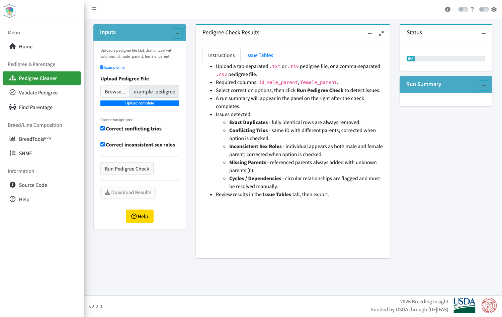

The checks run in this order:

| Issue | Meaning | Action |
|---|---|---|
| Exact duplicates | The identical row appears more than once | Always removed |
| Conflicting trios | Same `id`, different parents in different rows | Disagreeing parents set to `0` and rows collapsed, or flagged (option above) |
| Missing parents | A parent is listed but has no row of its own | Always added as a row with unknown parents (`0`) |
| Inconsistent sex roles | Same individual used as male and as female parent | Set to `0` as a parent everywhere, or flagged (option above) |
| Cycles / dependencies | An individual is its own ancestor, or is recorded as its own parent | Flagged only; fix it by hand, since there is no safe automatic choice |

The **Run Summary** counts the issues and the Issue Tables tab has one table per issue; an empty table means the issue was not found.

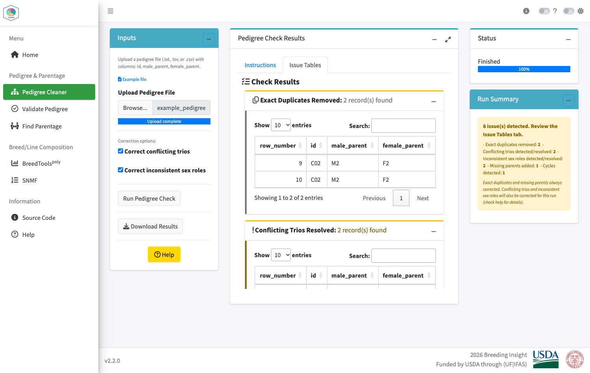

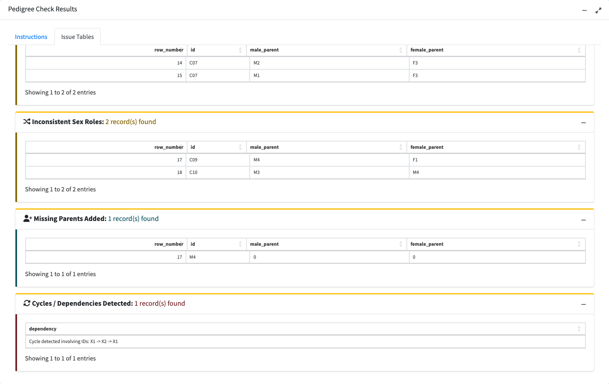

In the example, the Cleaner finds `r nrow(clean$exact_duplicates)` exact duplicate rows (the two copies of `C02`) and the `r nrow(clean$conflicting_trios)` rows of the conflicting trio `C07`, whose male parent is `M2` in one row and `M1` in the other: the corrected row keeps the female parent `F3` and sets the male parent to `0`. `M4` has no row, so it is added with unknown parents. `M4` is also the male parent of `C09` and the female parent of `C10`, so it is cleared from both rows (`r nrow(clean$inconsistent_sex_roles)` rows), although only the second role is wrong. This is safe: *Fill in pedigree* searches the cleared parents later. Last, `X1` and `X2` are each other's parent: the cycle is listed in Cycles / Dependencies Detected (each id is a recorded parent of the one before it) for you to fix in the pedigree record.

**Download Results** gives a zip with `corrected_pedigree.txt` and one file per issue type that has rows. Extra columns of the pedigree (for example a family or year column) are kept in the corrected pedigree only when no conflicting trio is collapsed. The corrected pedigree is the input of Validate Pedigree; for the example it is `example_pedigree_cleaned.txt`.

# Validate Pedigree

Validate Pedigree tests each recorded trio (offspring, male parent, female parent) against the genotypes with a Mendelian error analysis, and recommends which parent to remove from failing trios.

## Parameters

1. Upload the pedigree (the corrected pedigree from the Cleaner), the genotypes and, optionally, the founders file.
2. Set the parameters:
    - **Trio Error Threshold** (default 5%): maximum percentage of testable markers with a Mendelian error for a trio to *pass*. Lower values are stricter; with noisy dosage calls a higher value avoids failing correct trios.
    - **Single Parent Error Threshold** (default 2%): when a trio fails, each parent is tested alone on homozygous markers (see the box below). A parent above this value is the likely faulty one.
    - **Min Markers** (default 10): minimum number of testable markers to judge a trio. Trios below it are *Low Markers*, so no conclusion is drawn from too little data.
    - **Ploidy** (2 to 20): ploidy of the dosages.
3. Click **Run Validation**.

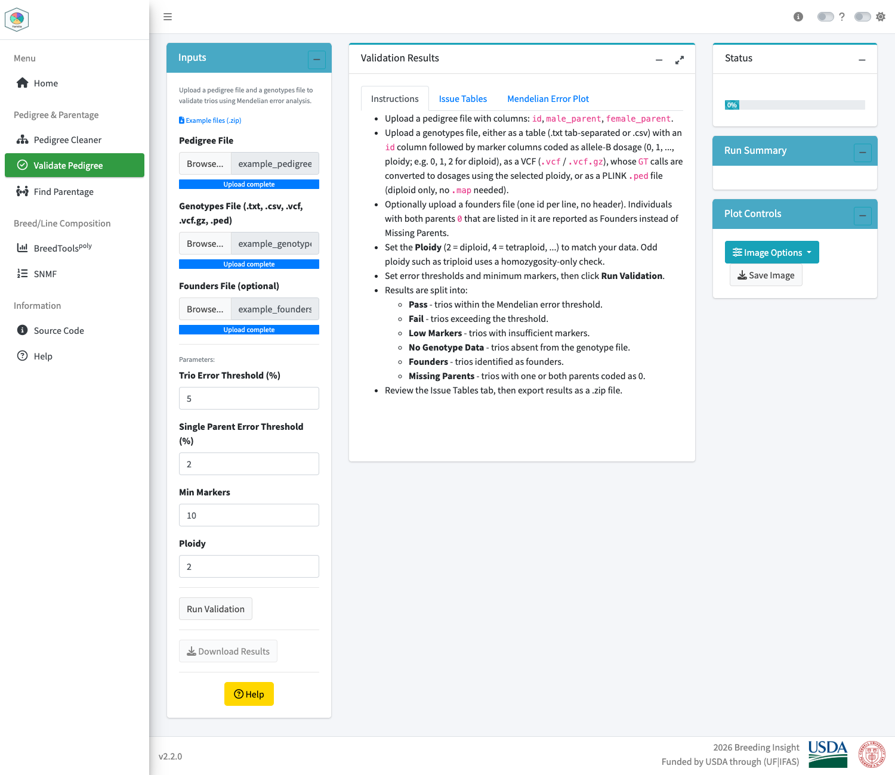

## Status of each trio

| Status | Meaning |
|---|---|
| Pass | Trio error at or below the Trio Error Threshold |
| Fail | Trio error above the threshold |
| Low Markers | Fewer than Min Markers testable markers |
| No Genotype Data | At least one of the three individuals is not in the genotype file |
| Founders | Both parents `0` and the id is in the founders file |
| Missing Parents | One or both parents are `0`, and the id is not a listed founder (`missing_both_parents`, `missing_male_parent` or `missing_female_parent` in `full_results.txt`) |

In the example, the Run Summary counts `r nrow(res)` individuals: `r nrow(val$pass)` pass, `r nrow(val$fail)` fail, `r nrow(val$low_markers)` with low markers, `r nrow(val$no_genotype_data)` without genotype data (`M4`, `X1` and `X2`), `r nrow(val$founders)` founders and `r nrow(val$missing_parents)` with a missing parent (`C07`, `C09` and `C10`, whose parents were cleared by the Cleaner). Start with the *Pass* table: these are the trios you can trust.

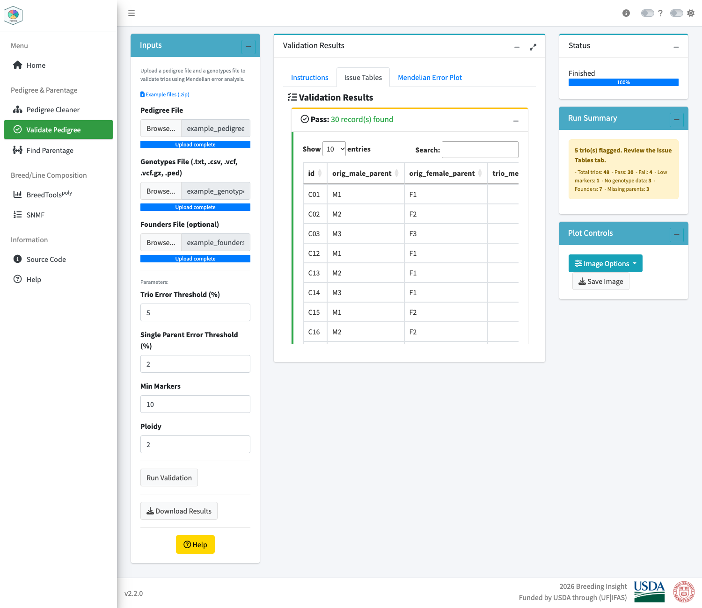

::: {style="background-color: #f4f8fb; border-left: 4px solid #2c7fb8; padding: 10px 16px; margin: 16px 0;"}
**How the trio test works**

The trio error uses **every marker where the offspring and both parents have a call**, heterozygous or homozygous. At each marker the question is whether the two parents can produce the offspring. Each parent passes on half of its alleles (ploidy / 2), so a parent with dosage *g* passes between max(0, *g* − ploidy / 2) and min(*g*, ploidy / 2) copies of allele B, and the offspring dosage must lie between the sum of the two minimums and the sum of the two maximums. For a diploid:

| Male parent | Female parent | Possible offspring |
|---|---|---|
| 0 | 0 | 0 |
| 0 | 1 | 0 or 1 |
| 0 | 2 | 1 |
| 1 | 1 | 0, 1 or 2 |
| 1 | 2 | 1 or 2 |
| 2 | 2 | 2 |

> trio error (%) = 100 × markers with an error / testable markers

A failed trio shows that the pair is wrong, but not which parent. Each parent is then tested alone with the **single-parent test**, which uses only the markers where the parent and the offspring are both homozygous: a parent homozygous for one allele passes it to every offspring, so an offspring homozygous for the other allele cannot be its offspring.

> single-parent error (%) = 100 × markers where parent and offspring are homozygous for different alleles / markers where both are homozygous

For odd ploidy the trio test also uses this opposite-homozygote rule. The [BIGpopA tutorial](https://github.com/Breeding-Insight/BIGpopA) (section *How the Mendelian error is calculated*, in the `docs` folder) goes through one trio marker by marker.
:::

## Failed trios and recommended correction

The *Fail* table gives, for each trio, the trio error, the markers tested, the single-parent error of each parent (`male_parent_hom_error_pct`, `female_parent_hom_error_pct`) and the `recommended_correction`:

| `recommended_correction` | Interpretation |
|---|---|
| `none` | Trio passes, or it is a founder, has a missing parent, has no genotype data or has no testable marker |
| `remove_male_parent` | The trio fails and only the male parent fails the single-parent test |
| `remove_female_parent` | The trio fails and only the female parent fails the single-parent test |
| `remove_both` | The trio fails and both parents fail the single-parent test |
| `unresolved` | The trio fails but neither parent fails the single-parent test; the record is probably wrong but the faulty parent cannot be identified |
| `low_markers_*` | The trio has fewer than Min Markers testable markers; the suffix is the decision the same rules would give (`low_markers_keep_both` means the error is within the threshold and both parents pass) |

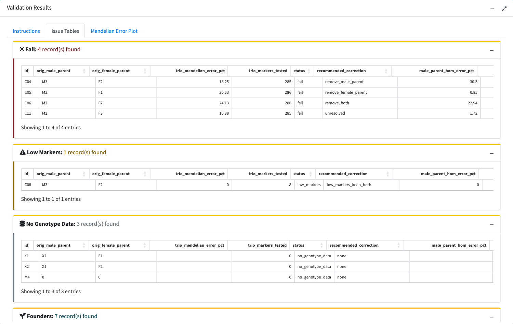

In the example, `C04` (recorded as `M3` x `F2`) has a trio error of `r get_val(res, "C04", "trio_mendelian_error_pct")`% over `r get_val(res, "C04", "trio_markers_tested")` markers. `M3` has a single-parent error of `r get_val(res, "C04", "male_parent_hom_error_pct")`% and `F2` of `r get_val(res, "C04", "female_parent_hom_error_pct")`%, so the recommendation is `remove_male_parent`. In the same way `C05` gets `remove_female_parent`, and `C06`, whose two recorded parents are wrong, `remove_both`.

`C11` also fails (`r get_val(res, "C11", "trio_mendelian_error_pct")`%), but its parents pass the single-parent test (`r get_val(res, "C11", "male_parent_hom_error_pct")`% and `r get_val(res, "C11", "female_parent_hom_error_pct")`%). The sample is a mix of two individuals' DNA, called heterozygous wherever they differ: it carries alleles that the pair cannot produce together, yet it never contradicts one parent alone. The recommendation is `unresolved`, and the record is left unchanged for you to check; here, by genotyping the sample again.

The **corrected pedigree** sets the parents named in `remove_*` decisions to `0`, including `low_markers_remove_*` decisions. Trios with `none`, `unresolved` or `low_markers_keep_both` are left unchanged. Validate does not propose replacement parents: run *Find Parentage > Fill in pedigree* on the corrected pedigree to search for them (see [Fill in pedigree](#fill-in-pedigree)).

The next tables list the trios that could not be judged, the founders and the missing parents.

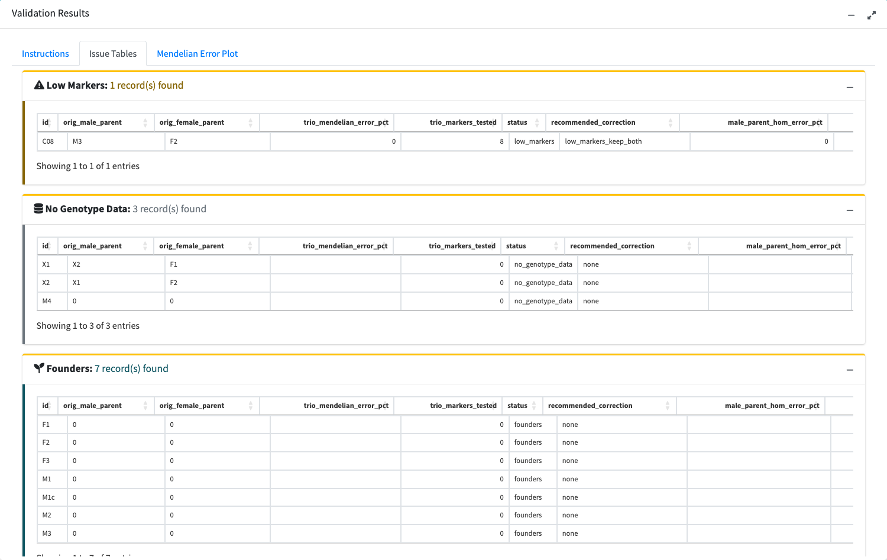

`C08` has only `r get_val(res, "C08", "trio_markers_tested")` testable markers. They agree with its parents (`r get_val(res, "C08", "recommended_correction")`), but they are too few to trust; genotype it again. `M4`, `X1` and `X2` have no genotypes, so the fix is to genotype them, not to edit the pedigree. The founders are the seven genotyped individuals listed in `example_founders.txt`; without the founders file they would be listed as missing both parents.

## Marker Summary

The Marker Summary lists every marker with `trios_tested`, `trios_mismatch` and `mismatch_pct`, sorted worst first. It answers a different question than the trio table: *is the problem the individual or the marker?*

- A few markers with a mismatch % far above the rest (paralogous loci, poor clustering, null alleles) inflate the error of many trios. Remove them from the genotype file and rerun.
- If errors are spread evenly over markers, the problem is in specific individuals or in the pedigree.
- Read percentages together with `trios_tested`: 1 of 2 trios is 50% but weak evidence.

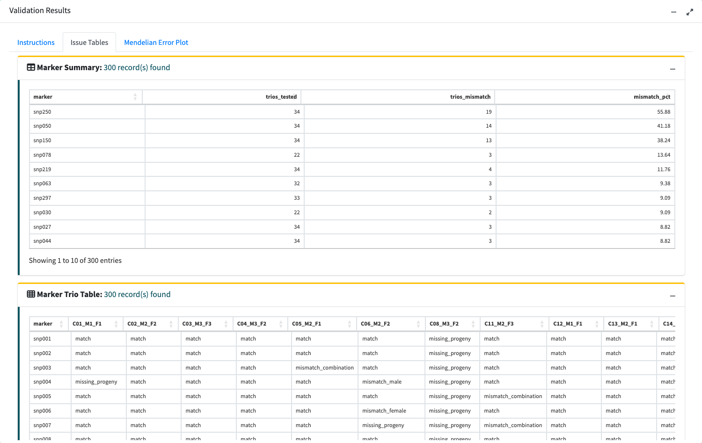

In the example, the three miscalled markers top the table: `r paste0("\x60", top_markers$marker, "\x60 (", top_markers$mismatch_pct, "%)", collapse = ", ")`, against a median of `r other_median`% for the other markers, whose few mismatches come from the four failed trios and occasional genotyping errors. A wrong call in a parent repeats in the trio of each of its offspring, so it can also make a single marker stand out.

## Marker Trio Table

The Marker Trio Table shows the verdict of every marker in every trio with both parents known and genotyped (one column per trio, named `id_male_female`). It shows where the error of a trio comes from.

| Label | Meaning |
|---|---|
| `match` | The trio is consistent at this marker |
| `mismatch_male`, `mismatch_female` | Only that parent is inconsistent with the offspring |
| `mismatch_both` | Each parent alone is inconsistent with the offspring |
| `mismatch_combination` | Each parent alone is compatible, but the pair cannot produce the offspring (the pattern of the contaminated `C11`) |
| `missing_male`, `missing_female`, `missing_progeny` | That individual has no call; one label names every missing individual (for example `missing_male_female`) |
| `untestable` | No call is missing, but the marker cannot be tested (odd ploidy, offspring not homozygous) |

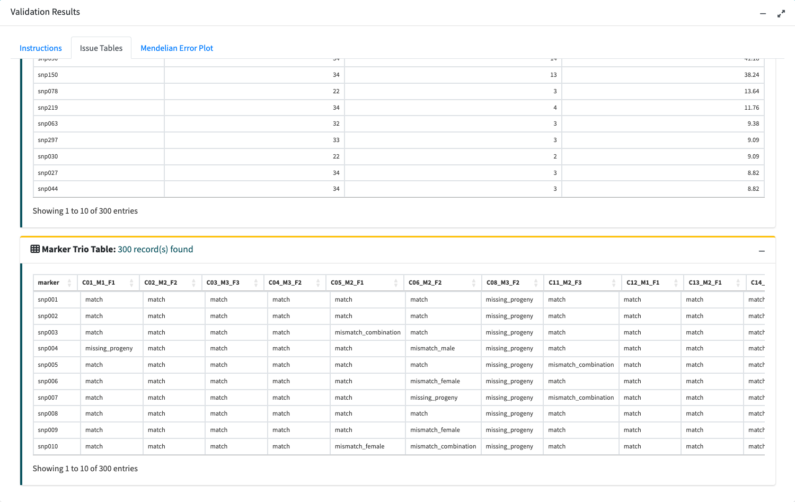

With many markers and trios the table is large; use `marker_trio_table.txt` from the download to work with it.

## Mendelian Error Plot

The plot is a histogram of the trio error (1% bins) of the trios with genotype data, with a dashed line at the Trio Error Threshold. Bars are coloured by outcome: pass (green), fail with one parent identified (yellow), fail with both parents failing (red) and fail with the parents unresolved (grey). The subtitle gives the trios tested and how many are above (lost) and at or below (kept) the threshold. A clear gap between passing and failing trios means the threshold is well placed; a continuum suggests noisy genotypes.

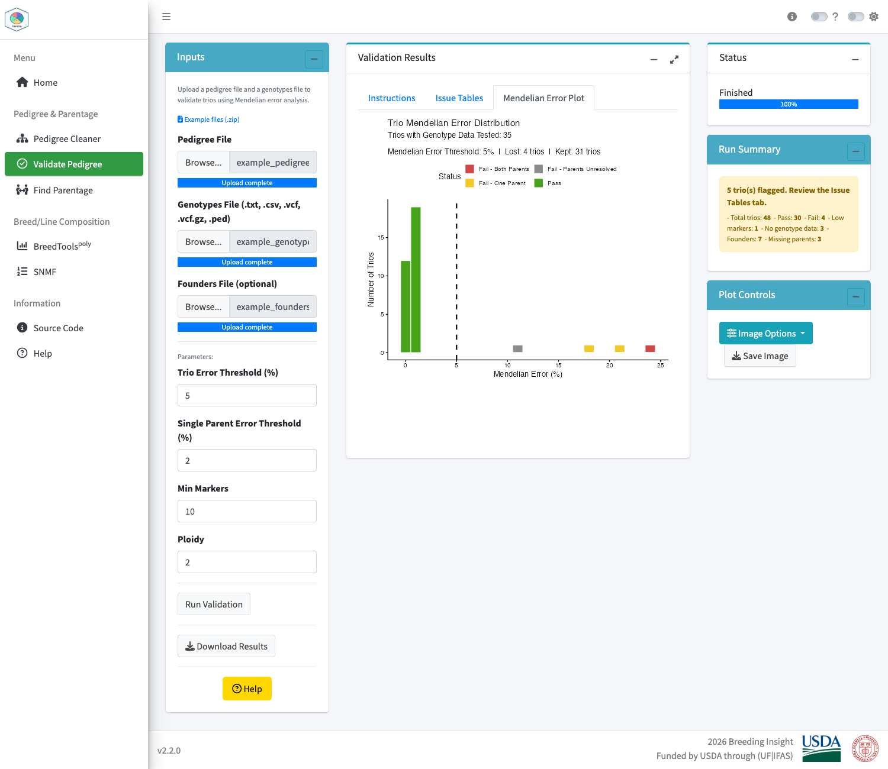

**Download Results** gives a zip with `corrected_pedigree.txt`, `full_results.txt`, one file per status, `marker_summary.txt` and `marker_trio_table.txt` (files for empty tables are not written). **Save Image** in Plot Controls saves the plot; **Image Options** sets the file type, resolution and size.

# Find Parentage

Find Parentage searches a pool of candidate parents for the best parent(s) of each offspring, using only genotypes.

## Parameters

1. Upload the genotypes, the parents file and the progeny file. The progeny file can be a list of ids (`id` column) or a pedigree (`id`, `male_parent`, `female_parent`); only a pedigree allows *Fill in pedigree*.
2. Choose a **Method**. The score of each candidate is reported as `mendelian_error_pct`; lower is better.

| Method | Candidates tested | Score |
|---|---|---|
| Best pair (default) | Every male x female pair (needs both sexes in the parents file) | Trio error, as in Validate Pedigree: all markers where the three individuals have a call |
| Best male parent / Best female parent | Each candidate of that sex alone | Single-parent error: only markers homozygous in both candidate and offspring |
| Best match | Each candidate of either sex alone | Single-parent error, as above |
| Fill in pedigree | The missing parent(s) of a pedigree; a known parent is kept fixed | Trio error (see [Fill in pedigree](#fill-in-pedigree)) |

Only the single-parent methods rely on homozygous markers. Prefer *Best pair* when both parents are among the candidates: it uses all markers and both parents together, so it separates candidates much better. Use the single-parent methods when the other parent is not genotyped.

3. Set the remaining parameters:
    - **Error Threshold (%)** (default 5): the best candidate is always reported, but above this error its status is `high_error` instead of `pass`.
    - **Min Markers** (default 10): with fewer markers tested, the status is `low_markers`.
    - **Ploidy** (2 to 20).
    - **Top N matches** (default 1): number of best candidates reported per offspring (see [Top N and ties](#top-n-and-ties)).
    - **Show ties** (default on): with *Best pair* and Top N = 1, tied best pairs are added as extra columns.
    - **Allow parent selfing** (default off): when off, pairs with the same male and female parent are excluded (*Best pair* only).
    - **Exclude self-match** (default on): an offspring is never tested as its own parent, which matters when offspring are also in the parents file.
4. Click **Run Parentage Assignment**.

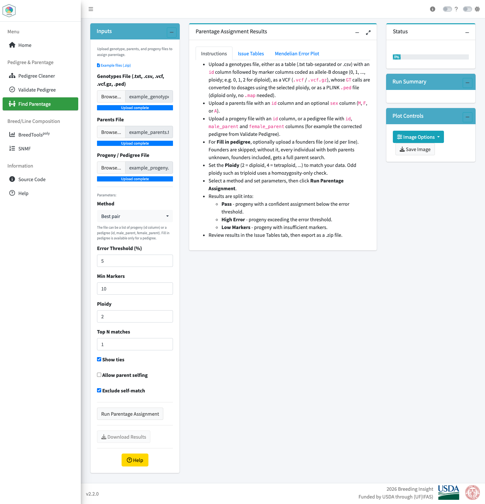

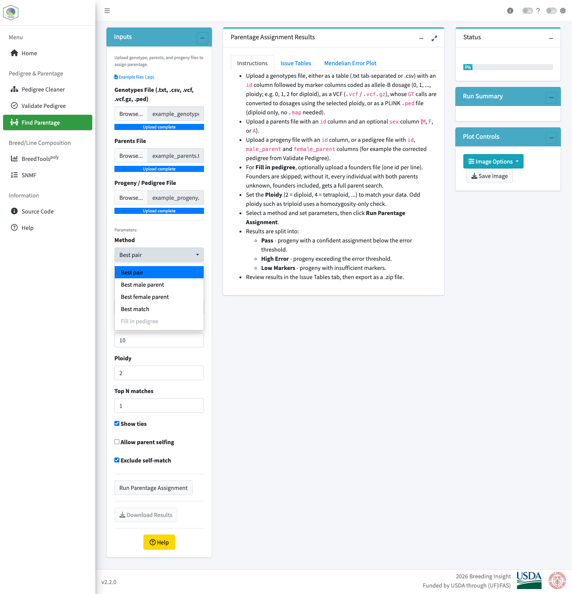

*Best pair* tests every male x female combination, so the run time grows with the product of the candidates. Restrict the parents file to plausible candidates (right generation and sex) to be faster and to reduce false matches.

## Results

The results are split into *Pass*, *High Error* and *Low Markers* tables with these columns:

| Column | Meaning |
|---|---|
| `id` | Offspring |
| `male_parent`, `female_parent` (*Best pair*, *Fill in pedigree*) or `best_match` (other methods) | Best candidate(s) |
| `mendelian_error_pct` | Score of the best candidate |
| `markers_tested` | Markers used for that score |
| `status` | `pass`, `high_error` (no candidate fits well: the true parent may be missing from the candidates), `low_markers` or, for *Fill in pedigree*, `known_parent_no_genotype` |
| `tied_candidates` | Candidates (pairs for *Best pair*) sharing the best score; above 1 means the assignment is ambiguous |
| `male_parent_2`, `female_parent_2`, `mendelian_error_pct_2`, `markers_tested_2`, ... (`best_match_2`, ... for the other methods) | Tied best pairs (Show ties, Top N = 1) or ranks 2 to N (Top N > 1) |
| `search_mode` (*Fill in pedigree*) | `known_male`, `known_female` or `pair` |
| `known_parent_error_pct` (*Fill in pedigree*) | Single-parent error of the parent that was kept; a high value suggests it is wrong too |

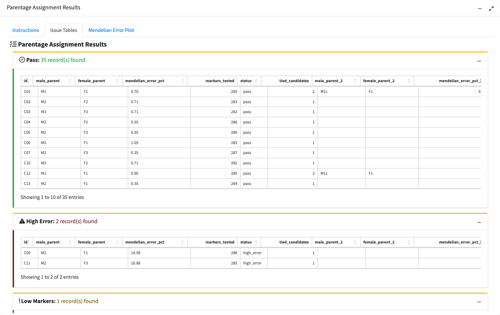

In the example, *Best pair* on the 38 offspring gives `r nrow(fp$pass)` pass, `r nrow(fp$high_error)` high error and `r nrow(fp$low_markers)` low markers. Every offspring that passes gets its true parents, including `C04`, `C05`, `C06`, `C07` and `C10`, whose records were wrong. The offspring of `M1` have `tied_candidates = 2`, because `M1` and `M1c` have the same genotypes: the extra columns give the other pair (for `C01`, `r get_val(fpr, "C01", "male_parent_2")` x `r get_val(fpr, "C01", "female_parent_2")`).

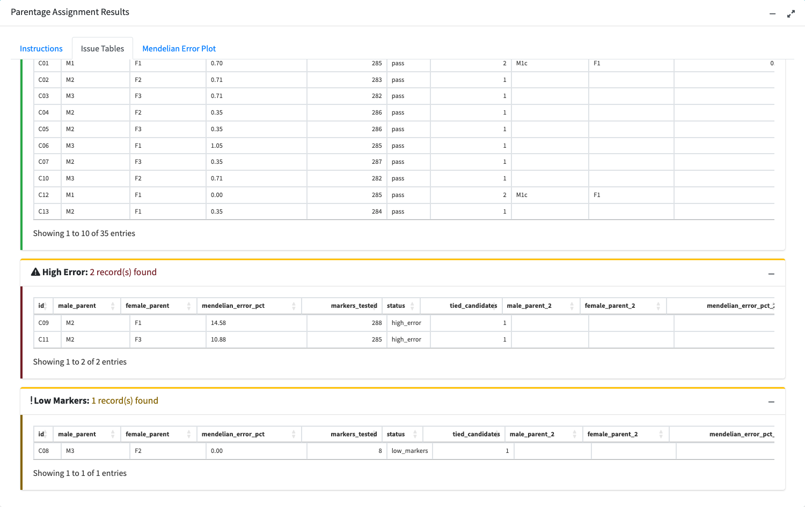

`C09` is `high_error`: its male parent `M4` is not genotyped, so even the best pair (`r get_val(fpr, "C09", "male_parent")` x `r get_val(fpr, "C09", "female_parent")`) has `r get_val(fpr, "C09", "mendelian_error_pct")`% error. The contaminated `C11` is also `high_error` (`r get_val(fpr, "C11", "mendelian_error_pct")`%), and `C08`, with `r get_val(fpr, "C08", "markers_tested")` markers tested, is `low_markers`.

**Download Results** gives a zip with `full_results.txt` (every offspring, including statuses that have no table, such as `known_parent_no_genotype`) and `pass.txt`, `high_error.txt` and `low_markers.txt`. **Save Image** saves the Mendelian Error Plot.

## Top N and ties

**Top N matches** reports the best N candidates per offspring, ranked by error (ties broken by the number of markers tested). Rank 1 stays in the base columns and ranks 2 to N are added with the suffixes `_2`, `_3`, and so on; the status refers to rank 1 only. With Top N above 1, ties are ranked like any other candidate, so Show ties has no effect.

- `tied_candidates = 1`: the best assignment is unique.
- `tied_candidates > 1`: several candidates cannot be told apart with the available markers. Do not accept the assignment blindly; add markers, or use other information (field records, generation, sex). Clones and duplicated samples, like `M1` and `M1c`, always tie.

A large gap between the error of rank 1 and rank 2 supports the assignment.

## Fill in pedigree

*Fill in pedigree* looks for the missing parents of a pedigree, typically the corrected pedigree from Validate Pedigree. It is available only when the progeny file has `id`, `male_parent` and `female_parent` columns; the parents file is still required.

- Unknown parents are coded `0`, `NA` or empty. Each row is handled on its own: a known male parent searches only females, a known female parent only males, and a row with both parents unknown gets the full pair search.
- Rows with both parents known are skipped and do not appear in the results.
- The known parent needs genotypes but does not need to be in the parents file; without genotypes the status is `known_parent_no_genotype`.
- **Founders File** (optional, appears when *Fill in pedigree* is selected): founders with both parents unknown are skipped. Without it, every individual with both parents unknown, founders included, gets a full pair search and is assigned the best, but meaningless, pair of candidates; the app shows a warning when you run without one.

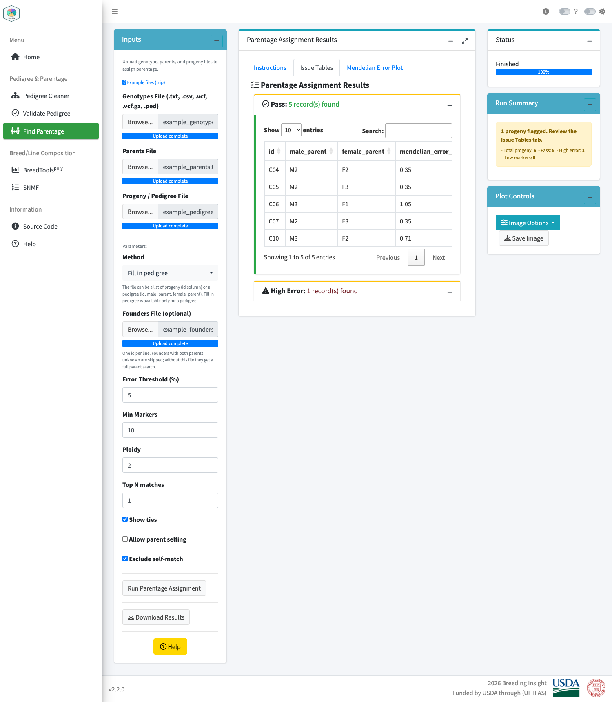

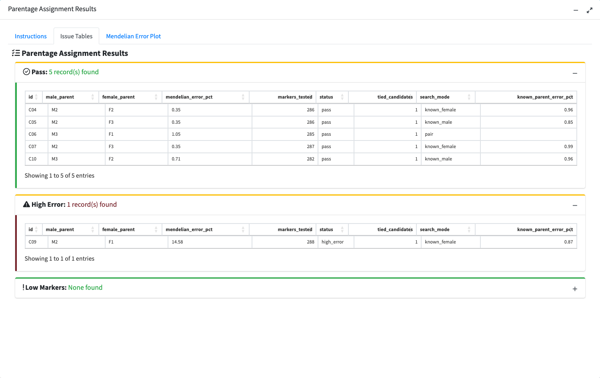

In the example, the progeny file is `example_pedigree_validated.txt` (the corrected pedigree from Validate Pedigree) and the founders file `example_founders.txt`. Only the `r nrow(fr)` rows with a missing parent are searched: `C04`, `C05` and `C06`, whose parents Validate removed, and `C07`, `C09` and `C10`, cleared by the Cleaner. The founders and the complete trios are skipped. `C04` keeps `F2` and gets `r get_val(fr, "C04", "male_parent")` (`search_mode = known_female`), `C05` keeps `M2` and gets `r get_val(fr, "C05", "female_parent")`, and `C06` gets the pair `r get_val(fr, "C06", "male_parent")` x `r get_val(fr, "C06", "female_parent")`. `C09` keeps `F1`, whose known parent error of `r get_val(fr, "C09", "known_parent_error_pct")`% confirms it, but no genotyped male fits (`high_error`), because its male parent `M4` has no genotypes.

# BreedTools<sup>poly</sup>

BreedTools estimates the proportion of each reference line or breed in each sample, from a set of reference samples with known membership (Funkhouser et al. 2017, extended to polyploids). It works for any ploidy.

## Parameters

1. Upload the reference genotypes, the Reference IDs file and the validation genotypes (the samples to assign).
2. Set:
    - **Ploidy**: 4 for the example files.
    - **Assignment threshold (%)** (default 50): a sample is assigned to its highest line only if that proportion reaches the threshold; otherwise it is *Undetermined*. With 0 every sample is assigned. Changing it updates the table and plot without rerunning.
3. Click **Run Estimation**.

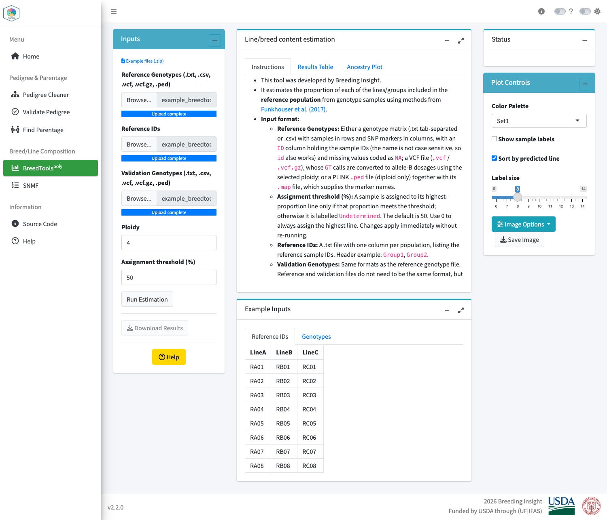

The references should be representative, unadmixed samples; the more distinct the lines, the better the estimate. Marker names must match between the reference and validation files. The files can be dosage tables, VCF or PLINK `.ped`; if either is a `.ped`, both must be, each with its `.map`. The Example Inputs box shows the format and downloads the example files.

## Results

The Results Table gives, for each sample, the percentage of each reference line, the `Predicted line` and `R2`. Proportions add to 100%: pure samples are close to 100% for one line, admixed samples split between lines.

`R2` measures how well the estimated mix of lines explains the sample: the squared correlation, across the sample's markers, between its dosages divided by the ploidy and the line frequencies weighted by its proportions. It describes the fit, not the accuracy of the proportions, and is usually well below 1 even for pure samples, because each dosage is one of a few values while the prediction is a frequency. Compare it between samples: a much lower `R2` than the rest suggests a line missing from the reference panel, or poor-quality genotypes.

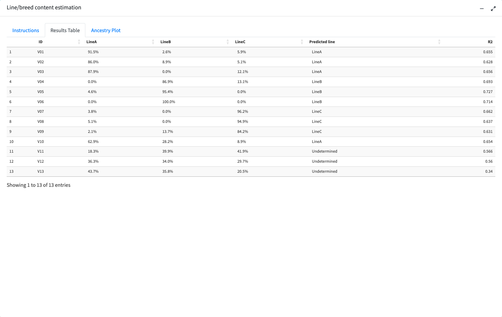

In the example, `V01` to `V09` get `r min(pure_pct)`% to `r max(pure_pct)`% of their own line; with 8 reference samples per line and 300 markers, pure samples rarely reach exactly 100%. `V10` is `r get_val(bt, "V10", "LineA")`% `LineA` and is assigned to it, while `V11` and `V12` have no line above 50% and are `Undetermined`. `V13` comes from a fourth line that is not in the reference panel: its proportions (`r paste0(names(v13), " ", unlist(v13), "%", collapse = ", ")`) look like an ordinary sample, but its `R2` is `r get_val(bt, "V13", "R2")`, against `r min(bt$R2[bt$ID != "V13"])` to `r max(bt$R2[bt$ID != "V13"])` for the other samples.

The Ancestry Plot shows the same proportions as stacked bars, one per sample. Use **Plot Controls** for the palette, sample labels and sorting.

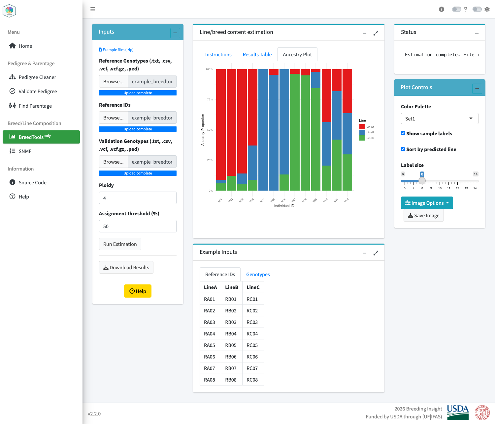

**Download Results** gives a zip with the Excel file `lineage_estimation_<date>.xlsx` (the Results Table, including `R2`). **Save Image** saves the plot.

# SNMF

SNMF estimates ancestry proportions without a reference panel, using sparse non-negative matrix factorization (`LEA::snmf()`). Use it to discover structure when you do not know the groups in advance. The example VCF has the 37 tetraploid samples of the BreedTools example.

## Parameters

1. Upload a `.vcf`, `.vcf.gz` or LEA `.geno` file.
2. Set:
    - **Ploidy**: must match the VCF, otherwise the run stops (4 for the example file).
    - **K min / K max** (defaults 1 and 10): the range of ancestral populations to try.
    - **Repetitions** (default 5): independent runs per K; more repetitions give more stable results.
    - **Alpha**, **Iterations**, **Tolerance**, **Percentage**, **CPU** and **Seed** are the `LEA::snmf()` settings (regularization, maximum iterations, convergence tolerance, share of genotypes masked to compute the cross-entropy, cores, random seed); the defaults suit most data sets.
    - **Selection mode**: *Auto-pick best K* (default) computes the cross-entropy and selects the K with the lowest value; *Manual K/run* computes it and lets you choose K; *No cross-entropy* skips it.
3. Click **Run SNMF**.

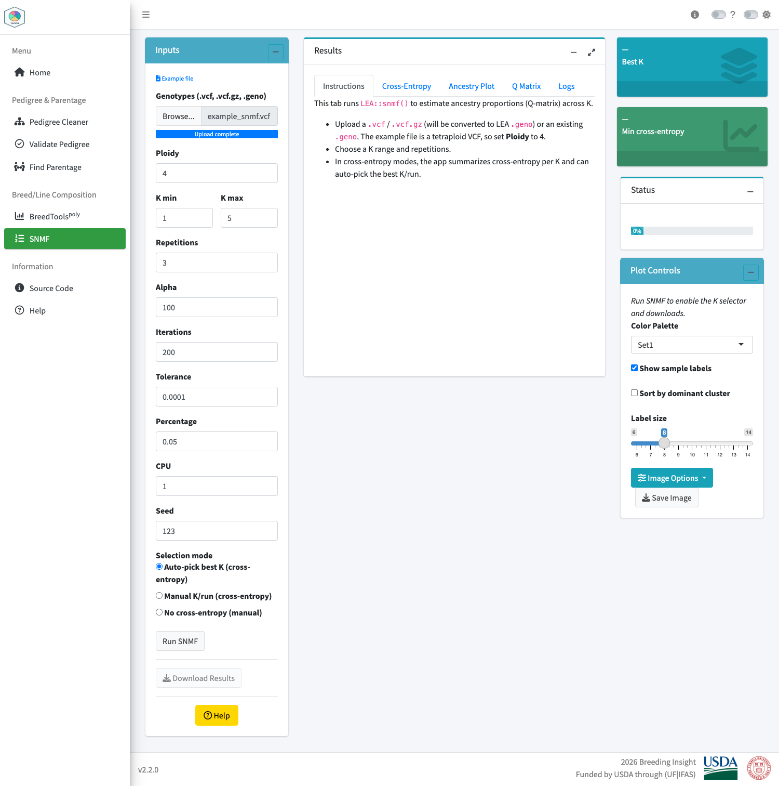

## Choosing K

The Cross-Entropy tab shows the lowest cross-entropy of each K. Choose K at the lowest value or where the curve flattens. In the example, the lowest value is at K = 3, the number of reference lines.


## Ancestry plot

The Ancestry Plot shows the ancestry coefficients of each sample at the selected K as stacked bars: samples dominated by one colour belong to one population, mixed colours indicate admixture. It uses the run with the lowest cross-entropy for that K; **Advanced Options**, under the K selector, lets you show another run to check how the repetitions converged.


**Download Results** gives a zip with the Q matrix of the selected K and run (`snmf_Q_K<k>_run<r>.csv`) and `snmf_cross_entropy.csv`. **Save Image** saves either plot.

# Run the same analysis in R

The pedigree and BreedTools tabs call BIGpopA functions, so the same results can be produced in a script, for example with the example files:

```{r}
library(BIGpopA)
ex <- function(f) system.file("extdata", f, package = "Familia")   # example files

clean  <- check_ped(ex("example_pedigree.txt"))
valid  <- validate_pedigree(clean$corrected_pedigree, ex("example_genotypes.txt"),
                            founders_file = ex("example_founders.txt"))
filled <- find_parentage(ex("example_genotypes.txt"), ex("example_parents.txt"),
                         valid$corrected_pedigree, method = "fill_pedigree",
                         founders_file = ex("example_founders.txt"))
```

See the [BIGpopA tutorial](https://github.com/Breeding-Insight/BIGpopA) for every function and option.

# Tips

- Typical workflow: Pedigree Cleaner -> Validate Pedigree -> Find Parentage (*Fill in pedigree*, with the founders file) on the corrected pedigree.
- Make sure you are using the right ploidy. A wrong ploidy gives many false failures.
- Upload the founders file in Validate Pedigree and in *Fill in pedigree*, so founders are neither reported as missing parents nor searched.
- Check the Marker Summary before blaming individuals; remove bad markers and rerun.
- Selfed, inbred or contaminated samples can fail the trio test; check the single-parent errors and the `unresolved` flag.
- Ties are common with few markers or with clones; always check `tied_candidates`.
- In BreedTools, compare `R2` between samples to spot samples that do not fit the reference panel.

# How to cite

## Familia

Chinchilla-Vargas J, Sandercock AM, Breeding Insight Team (2026). *Familia: 'shiny' Application for Population Structure and Ancestry Assessments*. R package version `r familia_version`. CRAN: <https://CRAN.R-project.org/package=Familia>

## BIGpopA

Chinchilla-Vargas J, Sandercock AM (2026). *BIGpopA: Pedigree Validation Genetic Composition of Diploids & Polyploids*. R package version `r as.character(utils::packageVersion("BIGpopA"))`. CRAN: <https://CRAN.R-project.org/package=BIGpopA>

Run `citation("Familia")` and `citation("BIGpopA")` in R for the BibTeX entries.

## Methods

- Frichot E, Mathieu F, Trouillon T, Bouchard G, Francois O (2014). Fast and efficient estimation of individual ancestry coefficients. *Genetics* 196:973-983. <https://doi.org/10.1534/genetics.113.160572> (sNMF)
- Frichot E, Francois O (2015). LEA: An R package for landscape and ecological association studies. *Methods in Ecology and Evolution* 6:925-929. <https://doi.org/10.1111/2041-210X.12382> (LEA)
- Funkhouser SA, Bates RO, Ernst CW, Newcom D, Steibel JP (2017). Estimation of genome-wide and locus-specific breed composition in pigs. *Translational Animal Science* 1(1):36-44. <https://doi.org/10.2527/tas2016.0003> (BreedTools)
- Sandercock AM, et al. (2025). *The Plant Genome*. <https://doi.org/10.1002/tpg2.70067> (BreedTools for polyploids)
